# Radiomics Feature Extraction & AI-Based Classification of Brain Tumors (MRI)

**A hybrid radiomics and machine-learning pipeline that classifies brain tumors on contrast-enhanced T1 MRI as meningioma, glioma or pituitary tumor, evaluated on patients the models never saw during training.**

[](https://colab.research.google.com/github/VCircuitX/hybrid-radiomics-brain-tumor-classification/blob/main/notebooks/Radiomics_BrainTumor.ipynb)


> ⚠️ This is a research and learning project. It is **not** a clinically validated diagnostic tool.

---

## At a glance

| | |
|---|---|
| **Task** | 3-class tumor classification (meningioma / glioma / pituitary) from 2-D MRI slices |
| **Data** | Public Figshare brain tumor dataset (Cheng et al.): **1,532 slices, 163 patients** used |
| **Features** | **2,250 per slice**: tumor radiomics, peritumoral radiomics, location and ResNet-50 deep features |
| **Models** | Logistic Regression, SVM, KNN, Random Forest, XGBoost, MLP, soft-voting ensemble |
| **Validation** | Patient-level 80/20 split + 5-fold patient-grouped cross-validation (no patient leakage) |
| **Best model** | Soft-voting ensemble (LR + SVM + RF + XGBoost), chosen by CV before the test set was used |
| **Test accuracy** | **95.38%** on 325 slices from 33 unseen patients (macro AUC 0.994) |
| **Patient-level accuracy** | **96.97%** (32 of 33 patients) |
| **Explainability** | SHAP, permutation importance, model feature importance |

### Skills demonstrated

Medical image analysis · radiomics (PyRadiomics, IBSI-aligned features) · feature engineering · transfer learning (ImageNet ResNet-50 as a feature extractor) · feature selection · classical ML and ensembles · leakage-free patient-grouped validation · clinical evaluation metrics (sensitivity, specificity, AUC, kappa, MCC) · explainable AI (SHAP) · Python scientific stack · reproducible Colab workflow

---

## Why this matters

Meningioma, glioma and pituitary tumors are managed very differently, so identifying the tumor type early matters. This project asks whether quantitative image features (radiomics), combined with standard machine-learning models, can predict the tumor type from an MRI slice and its expert tumor outline, and whether the prediction can be explained.

---

## Pipeline

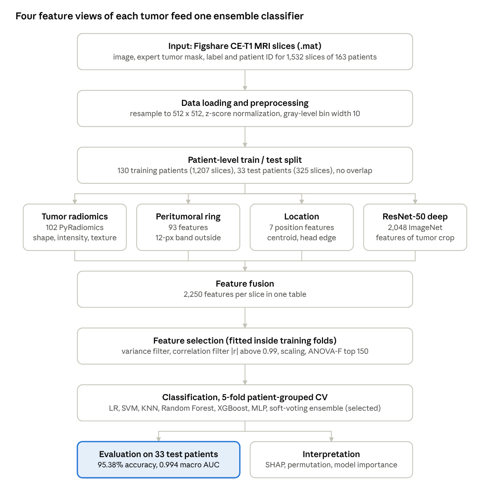

1. **Load data:** read each Figshare `.mat` file (image, expert tumor mask, label, patient ID). Slices with a tumor mask smaller than 20 pixels are removed.
2. **Patient-level split:** 130 training patients (1,207 slices) and 33 test patients (325 slices), stratified by tumor type. No patient appears in both sets, and the code checks this.
3. **Preprocessing:** 256 × 256 slices are resampled to 512 × 512, then z-score intensity normalization (scale 100) and gray-level discretization (bin width 10) are applied.
4. **Feature extraction (2,250 features per slice):**

   | Feature group | Count | What it describes |
   |---|---|---|
   | Tumor radiomics (PyRadiomics) | 102 | Shape-2D, first-order intensity, and GLCM, GLRLM, GLSZM, GLDM and NGTDM texture inside the tumor |
   | Peritumoral radiomics | 93 | Intensity and texture of a 12-pixel ring of tissue just outside the tumor |
   | Location | 7 | Tumor centroid, distance to the image/head center and head edge, tumor-to-head area ratio |
   | Deep features | 2,048 | ImageNet-pretrained ResNet-50 applied to the tumor crop (fixed, no fine-tuning) |

5. **Feature selection** runs *inside* the scikit-learn pipeline, so it is re-fitted on each training fold: median imputation, then variance threshold, then correlation filter, then standardization, then ANOVA-F top-K. K and the correlation threshold were tuned by 5-fold patient-grouped CV on the training set only; the best setting was **K = 150, |r| > 0.99**.
6. **Classification:** seven classifiers with balanced class weights, compared with `StratifiedGroupKFold` (5 folds, grouped by patient).
7. **Model selection:** the model with the highest cross-validated macro-F1 (the soft-voting ensemble) was chosen **before** touching the test set.
8. **Evaluation:** accuracy, balanced accuracy, precision, sensitivity, specificity, F1, macro AUC, Cohen's kappa and MCC, at slice level and patient level (patient level averages the slice probabilities per patient).
9. **Interpretation:** Random Forest and XGBoost importances, permutation importance and SHAP.

---

## Dataset

- **Source:** Figshare brain tumor dataset by Jun Cheng, [doi:10.6084/m9.figshare.1512427](https://doi.org/10.6084/m9.figshare.1512427)
- **Content of the full dataset:** 3,064 contrast-enhanced T1-weighted MRI slices from 233 patients, with expert tumor masks, distributed as 4 zip files of 766 slices each
- **Used in this project:** the first two zip files (**slices 1–1,532, from 163 patients**)

| Tumor type | Slices | Patients |
|---|---|---|
| Meningioma | 705 | 79 |
| Glioma | 205 | 22 |
| Pituitary | 622 | 62 |
| **Total** | **1,532** | **163** |

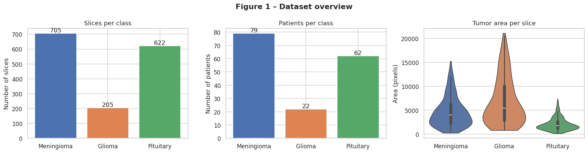

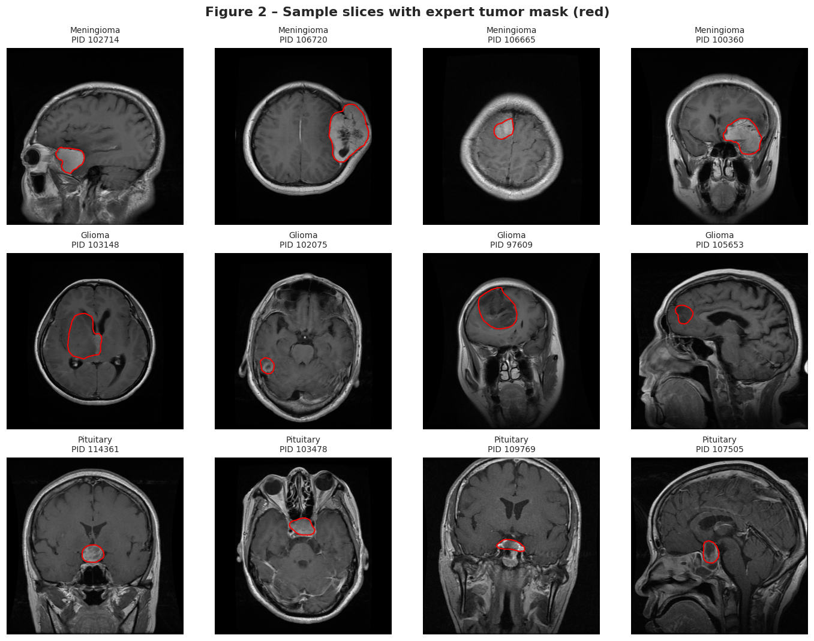

**The dataset is not included in this repository.** Please download it from the original Figshare page and follow its licence and citation terms (see [References](#references)).

---

## Results

### Cross-validation on the training set (5-fold, patient-grouped, mean ± SD)

| Model | CV Accuracy | CV Macro-F1 | CV AUC |
|---|---|---|---|
| Logistic Regression | 0.892 ± 0.030 | 0.874 ± 0.031 | 0.976 ± 0.012 |
| SVM (RBF) | 0.911 ± 0.033 | 0.900 ± 0.028 | 0.977 ± 0.011 |
| KNN | 0.868 ± 0.047 | 0.820 ± 0.059 | 0.953 ± 0.013 |
| Random Forest | 0.897 ± 0.062 | 0.883 ± 0.055 | 0.975 ± 0.017 |
| XGBoost | 0.919 ± 0.039 | 0.905 ± 0.038 | 0.981 ± 0.011 |
| MLP | 0.904 ± 0.036 | 0.886 ± 0.046 | 0.976 ± 0.017 |
| **Ensemble (soft voting)** | **0.921 ± 0.038** | **0.913 ± 0.035** | **0.983 ± 0.012** |

### Independent test set (33 unseen patients, 325 slices)

| Model | Accuracy | Precision | Sensitivity | Specificity | Macro-F1 | Macro AUC |
|---|---|---|---|---|---|---|
| Logistic Regression | 0.9262 | 0.9175 | 0.9191 | 0.9586 | 0.9180 | 0.9899 |
| SVM (RBF) | 0.9446 | 0.9513 | 0.9454 | 0.9675 | 0.9482 | 0.9923 |
| KNN | 0.9385 | 0.9547 | 0.9085 | 0.9637 | 0.9276 | 0.9908 |
| Random Forest | 0.9508 | 0.9561 | 0.9448 | 0.9721 | 0.9493 | 0.9920 |
| XGBoost | 0.9385 | 0.9403 | 0.9421 | 0.9653 | 0.9404 | 0.9958 |
| MLP | 0.9415 | 0.9489 | 0.9436 | 0.9660 | 0.9459 | 0.9940 |
| **Ensemble (soft voting)** | **0.9538** | **0.9583** | **0.9597** | **0.9736** | **0.9586** | **0.9944** |

Ensemble: Cohen's kappa 0.922 and MCC 0.923 on the test set.

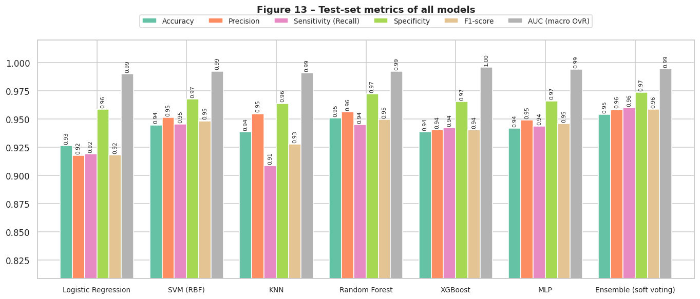

### Best model: per-class test performance

| Class | Sensitivity | Specificity | Precision | F1 | AUC |
|---|---|---|---|---|---|
| Meningioma | 0.9286 | 0.9766 | 0.9728 | 0.9502 | 0.9900 |
| Glioma | 0.9730 | 0.9965 | 0.9730 | 0.9730 | 0.9985 |
| Pituitary | 0.9776 | 0.9476 | 0.9291 | 0.9527 | 0.9947 |

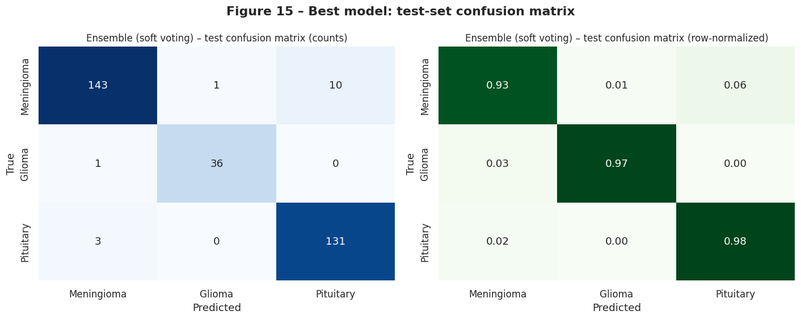

The most common error was **meningioma slices predicted as pituitary tumor (10 of 154 meningioma slices)**. A possible explanation, not tested in this project, is that some meningiomas lie near the skull base close to the pituitary region, so their location features overlap.

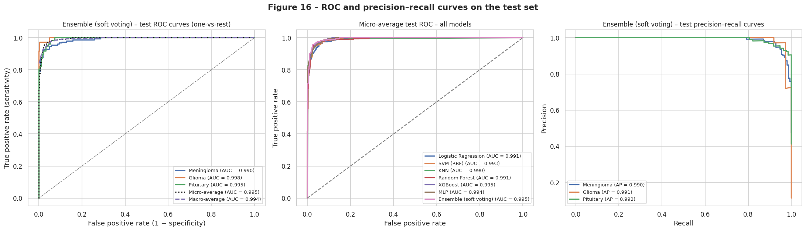

### Generalization and patient-level results

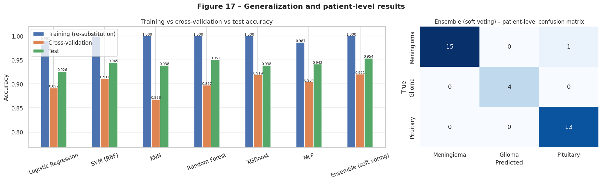

- At **patient level**, the ensemble classified **32 of 33** test patients correctly (accuracy 0.9697, macro AUC 1.00).
- Several models reach 100% accuracy on their own training data but 87–92% in cross-validation. This shows some overfitting, so the **cross-validation score is the more conservative estimate**.
- Test accuracy (95.4%) is higher than CV accuracy (92.1%). With only 33 test patients, a few patients can move test accuracy by several percentage points.

### Effect of the number of selected features

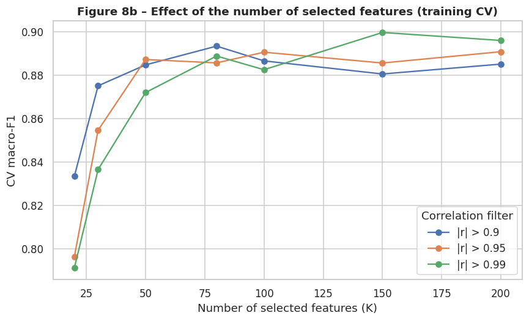

The 150 selected features came from every feature group: 55 deep, 52 peritumoral, 38 tumor radiomics and 5 location features. On the training set, 1,236 of the 2,250 features differed significantly between tumor types (Kruskal–Wallis, Bonferroni-corrected p < 0.05).

---

## Model interpretation

SHAP values for XGBoost on the test set, one plot per tumor type:

| Meningioma vs rest | Glioma vs rest | Pituitary vs rest |
|---|---|---|
| 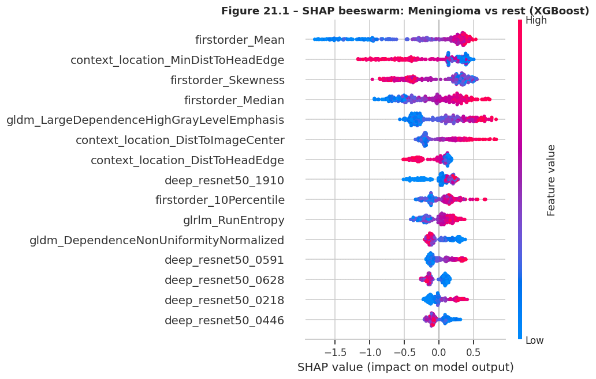 | 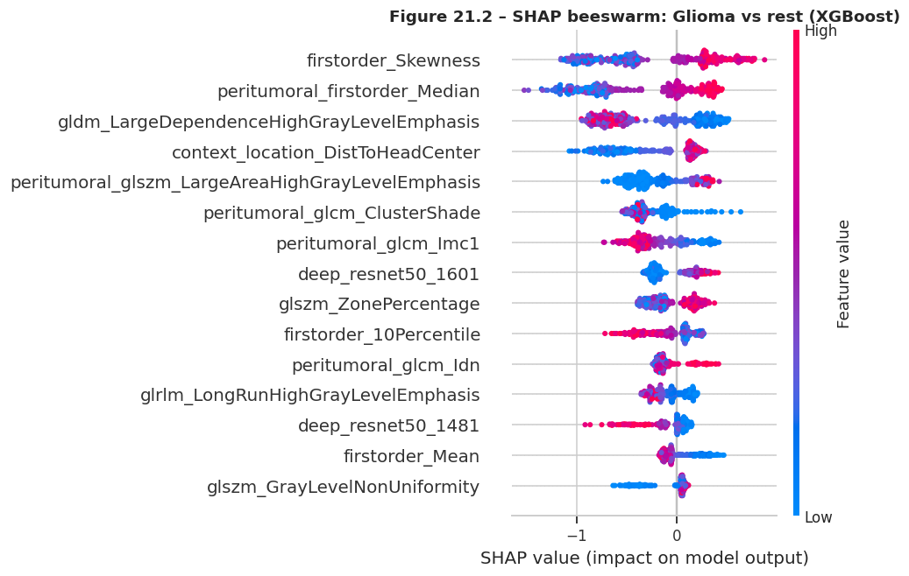 | 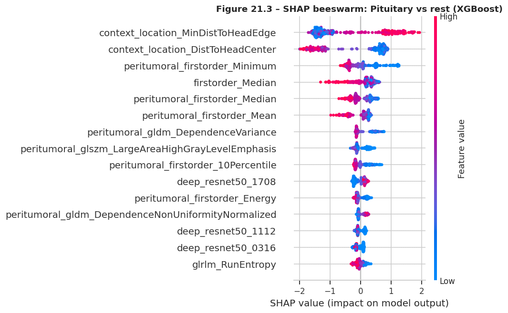 |

- **Pituitary:** location features dominate. A larger distance from the head edge and a smaller distance to the head center push the prediction toward pituitary, which matches where these tumors usually sit (centrally).
- **Meningioma:** tumor mean intensity is the top feature. Being close to the head edge also pushes toward meningioma.
- **Glioma:** tumor intensity skewness and peritumoral median intensity are the top features.

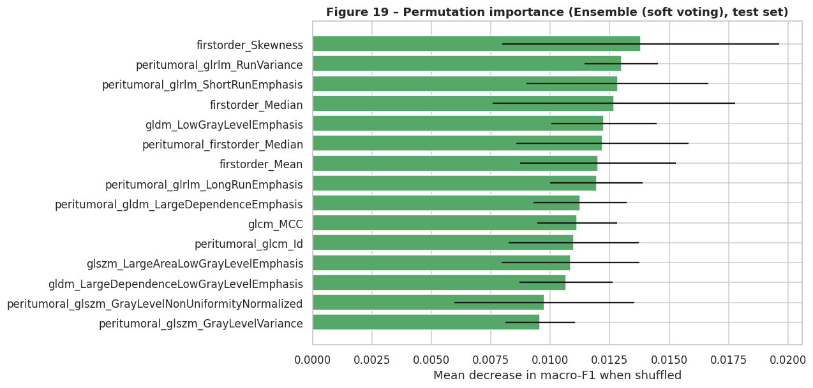

For the ensemble, permutation importance is spread over many features (each feature alone lowers macro-F1 by about 0.01–0.014 when shuffled). The top features are a mix of tumor intensity and peritumoral texture features.

---

## Repository structure

```
hybrid-radiomics-brain-tumor-classification/
├── README.md                 ← this page
├── requirements.txt          ← Python libraries used
├── LICENSE                   ← MIT licence for the code
├── CITATION.cff              ← how to cite this repository
├── notebooks/
│   └── Radiomics_BrainTumor.ipynb   ← full pipeline with all outputs saved
├── figures/                  ← selected figures produced by the notebook
└── results/                  ← selected result tables (CSV) produced by the notebook
```

---

## How to reproduce

The project was developed and run in **Google Colab** (Python 3.12).

1. Download the Figshare brain tumor dataset from the [original page](https://doi.org/10.6084/m9.figshare.1512427).
2. Put the data in your Google Drive. **To match the results above, use only the first two zip files (slices 1–1,532).** Using all four will give different numbers.
3. Open the notebook in Colab with the **Open in Colab** badge at the top of this page.
4. Run all cells. The notebook mounts Google Drive, finds the Figshare data (or asks you to upload a zip), installs the libraries, and saves every figure and table to `MyDrive/radiomics_results`.

Notes:
- A GPU runtime (for example a Colab T4) speeds up the ResNet-50 deep-feature step.
- All settings (split ratio, folds, number of features, feature groups on/off) are in the configuration cell in Section 2.
- The random seed is fixed (`SEED = 42`). Results may still differ slightly between library versions.
- You can view the notebook with all outputs here on GitHub without running anything.

---

## Requirements

Main libraries: **PyRadiomics** (installed from its official GitHub source, because the PyPI release does not build on Colab's Python 3.12), SimpleITK, scikit-learn, XGBoost, SHAP, PyTorch and torchvision, NumPy, pandas, SciPy, scikit-image, PyWavelets, h5py, joblib, Matplotlib, Seaborn and openpyxl.

```bash
pip install -r requirements.txt
```

---

## Limitations

- Only **1,532 of the 3,064** Figshare slices (163 of 233 patients) were used. Glioma is the most under-represented class: 205 of 1,426 available glioma slices.
- The test set is small (33 patients, only 4 with glioma), so test metrics carry an uncertainty of several percentage points.
- A single train/test split was used. Repeated or nested cross-validation would give a more robust estimate.
- The method needs the **expert tumor mask** as input. It does not find the tumor by itself.
- The models are trained and tested on 2-D slices from one public dataset and one MRI sequence. Performance on other hospitals or scanners is unknown.
- Interpretation (SHAP, permutation importance) was computed on the test set.

## Future improvements (suggestions)

*These are ideas for extending the work. They have not been done in this project.*

- Re-run the pipeline on the **full dataset** (3,064 slices, 233 patients) with repeated patient-wise cross-validation.
- Add automatic tumor segmentation (for example a U-Net) so no manual mask is needed.
- Enable the Wavelet and Laplacian-of-Gaussian radiomic filters already supported in the notebook (`ENABLE_FILTERS = True`).
- Fine-tune a CNN on brain MRI instead of using fixed ImageNet features.
- Validate on an external dataset from another hospital.
- Build a small demo app (for example Streamlit) that shows the prediction with its SHAP explanation.

---

## References

1. J. Cheng, "Brain tumor dataset," figshare, 2017. [doi:10.6084/m9.figshare.1512427](https://doi.org/10.6084/m9.figshare.1512427)
2. J. Cheng et al., "Enhanced performance of brain tumor classification via tumor region augmentation and partition," *PLoS ONE*, 10(10): e0140381, 2015. [doi:10.1371/journal.pone.0140381](https://doi.org/10.1371/journal.pone.0140381)
3. J. J. M. van Griethuysen et al., "Computational radiomics system to decode the radiographic phenotype," *Cancer Research*, 77(21): e104–e107, 2017. [doi:10.1158/0008-5472.CAN-17-0339](https://doi.org/10.1158/0008-5472.CAN-17-0339)
4. A. Zwanenburg et al., "The Image Biomarker Standardization Initiative," *Radiology*, 295(2): 328–338, 2020. [doi:10.1148/radiol.2020191145](https://doi.org/10.1148/radiol.2020191145)
5. K. He et al., "Deep residual learning for image recognition," *Proc. IEEE CVPR*, 2016.
6. T. Chen and C. Guestrin, "XGBoost: A scalable tree boosting system," *Proc. ACM SIGKDD*, 2016.
7. S. M. Lundberg and S.-I. Lee, "A unified approach to interpreting model predictions," *NeurIPS*, 2017.
8. F. Pedregosa et al., "Scikit-learn: Machine learning in Python," *JMLR*, 12: 2825–2830, 2011.

If you use the dataset, please cite the dataset itself (reference 1) and the original paper that introduced it (reference 2).

---

## Author

**Vishnu D A** ([@VCircuitX](https://github.com/VCircuitX)), biomedical engineering portfolio project.

Feedback and questions are welcome: please open an [issue](https://github.com/VCircuitX/hybrid-radiomics-brain-tumor-classification/issues).
